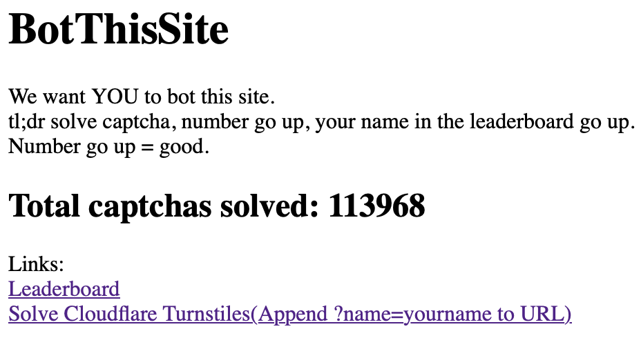
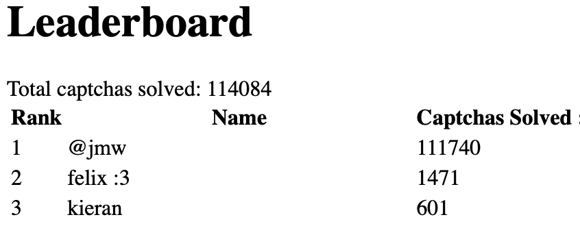
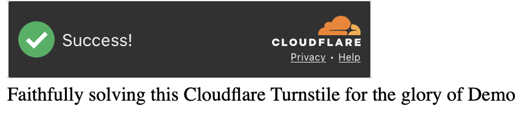

# BotThisSite

We want you to absolutely not bot this site.  
It's probably forbidden to bot this site.  
Absolutely forbidden. After all, we're protected by captchas.  
Surely you can't bot this site after all, I'm behind a ton of captchas.  
If you somehow magically do it :tm:, we will record your name and how many times you do it.  
So, like, a leaderboard where if you solve the captcha number go up, number go up = good.  
The site is intentionally sparse until I add CSS, and you should memorize links.  

## Images:
\
\

## Tech Stack:
Update: Kieran has optimized, thank you.  
Prod will die if it is not optimized.  

If premature optimization is a sin, then i should be in heaven for how tossed-together this is.  
I personally feel like this should implode but its not! so good!  
* Python - the ... language?  
* FastAPI - the api thingy  
* Jinja2 templates - for making pages with templates... 
* SQLite + SQLmodel- databae  
* Cloudflare Turnstiles - this is the first captcha implemented. 
* 8 core homelab? details somewhere
* behind cf because... load

## Setup
* get cloudflare, recaptcha, etc tokens put in .env according to .env.example
* `uv run fastapi dev main.py` for dev

## Todo:
See `TODO.md`

## AI Usage:
Contributing: Be sane with AI, know what it writes. Denote/label AI contributions somewhere.

* AI was used to help make this, unfortunately.
* AI was used for assistance when i was stuck/confused how to continue.
* Amp Code was one of the tools utilized.
* I wish I had all the skills to efficiently do it how the LLM does it - while it makes mistakes, I do intend to still learn.
* as of the current commit, the migration to more models and better provider setups was handled by amp code. (it convinced me to not have everything as a sql column)

